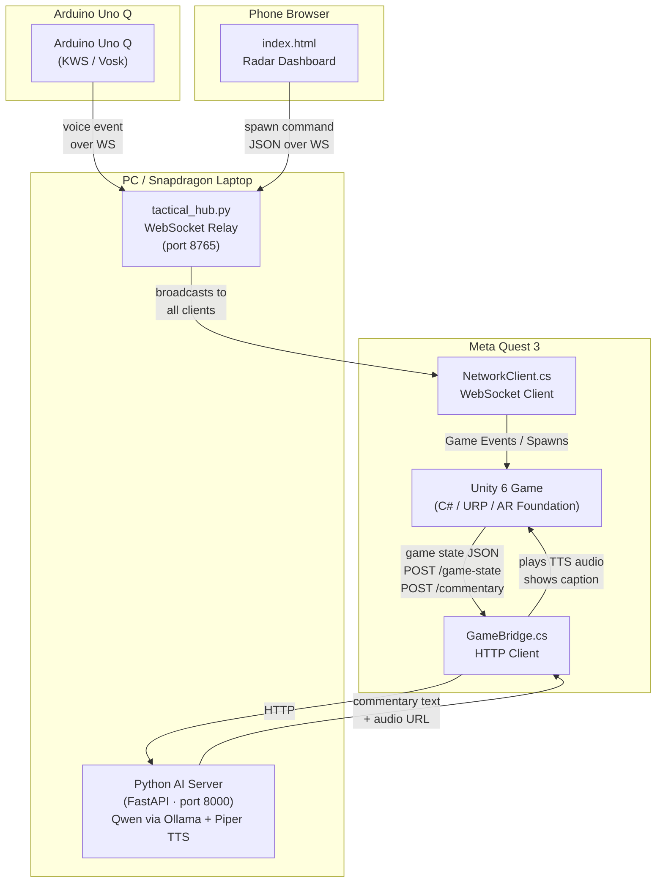
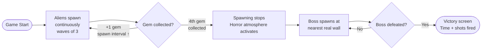
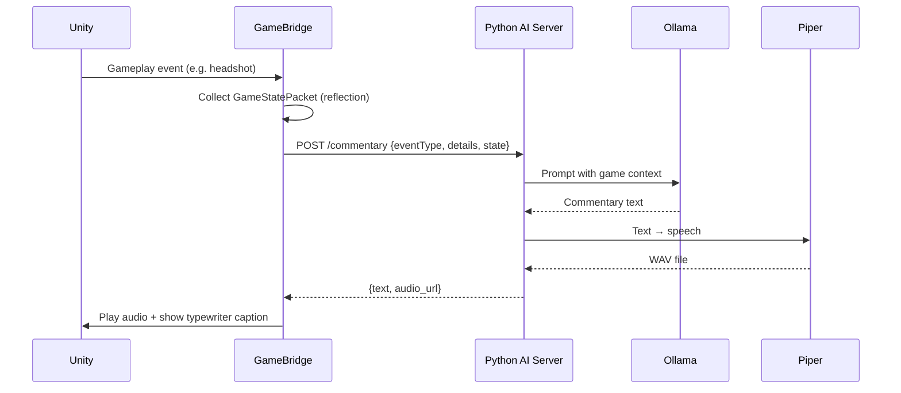
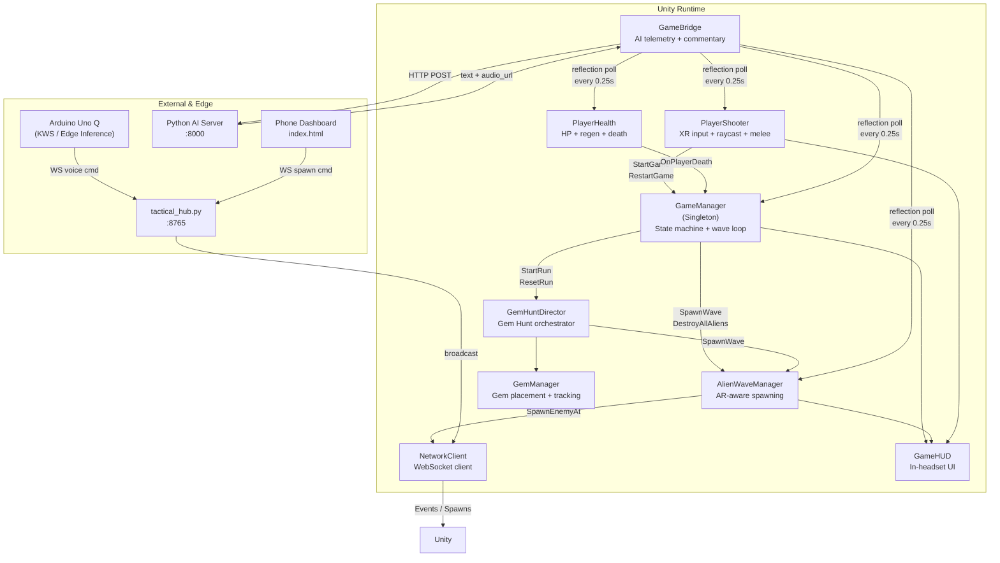

<div align="center">

# QUANTUMSHIFT-XR

**A Mixed Reality Alien Shooter for Meta Quest 3**  
**Powered by a local LLM, an embedded Arduino voice interface, a companion radar dashboard, and your own living room**

*Built in 24 hours · Snapdragon Multiverse Hackathon Finale · Qualcomm Bangalore Campus · July 2026*

---


</div>

---


## Table of Contents

- [Overview](#overview)
- [Features](#features)
- [System Architecture](#system-architecture)
- [Technology Stack](#technology-stack)
- [Repository Structure](#repository-structure)
- [How It Works](#how-it-works)
  - [Gem Hunt Mode](#gem-hunt-mode)
  - [Classic Wave Mode](#classic-wave-mode)
  - [AI Commentary Pipeline](#ai-commentary-pipeline)
  - [Embedded Voice Command Subsystem](#embedded-voice-command-subsystem-keyword-spotting)
  - [Game Master Dashboard](#game-master-dashboard)
  - [AR-Aware Spawning](#ar-aware-spawning)
- [Setup & Installation](#setup--installation)
  - [Prerequisites](#prerequisites)
  - [1 · Unity Project](#1--unity-project)
  - [2 · Python AI Server (optional)](#2--python-ai-server-optional)
  - [3 · Arduino Uno Q (Voice Pipeline)](#3--arduino-uno-q-voice-pipeline)
  - [4 · Tactical Hub WebSocket Relay (optional)](#4--tactical-hub-websocket-relay-optional)
  - [5 · Phone Game Master Dashboard (optional)](#5--phone-game-master-dashboard-optional)
- [Controls](#controls)
- [3D-Printable Gun Attachment](#3d-printable-gun-attachment)
- [Current Architecture](#current-architecture)
- [Current Limitations](#current-limitations)
- [Future Improvements](#future-improvements)
- [Contributing](#contributing)
- [License](#license)
- [Acknowledgements](#acknowledgements)

---

## Overview

QUANTUMSHIFT-XR turns the player's physical room into a battlefield. Using Meta Quest 3 passthrough and the AR Foundation Scene API, aliens spawn on real furniture, behind real walls, and on the floor of your actual space. The player shoots, punches, and dodges through waves of enemies while hunting four hidden gems that escalate the tension — until the room goes dark and a boss emerges from the nearest wall.

A local AI commentary system (Qwen via Ollama + Piper TTS) watches every kill, headshot, and health drop and delivers spoken commentary through the headset — no cloud API required. An onboard **Arduino Uno Q** running edge Keyword Spotting (KWS via Vosk) captures local voice commands without network round-trip delay. A second player can open a radar dashboard on a phone browser and tap to spawn enemies anywhere in the room, in real time.

---

## Features

| Feature | Details |
|---|---|
| 🔫 **Raycast combat** | Physics-layer-filtered hits; location damage (headshots deal 3× body) |
| 🥊 **Velocity melee** | Fast controller swing registers a melee punch |
| 🎯 **Aim Down Sights** | Controller-to-camera proximity detection boosts damage and tightens spread |
| 💎 **Gem Hunt mode** | 4 gems hidden in real furniture; each gem tightens the spawn interval |
| 🌑 **Horror atmosphere** | Room darkens after final gem; red fog, embers, lightning, rumble |
| 👾 **Boss fight** | Final boss spawns at the nearest real wall and stalks through the dark |
| 🧠 **Local AI commentary** | Qwen (via Ollama) + Piper TTS; zero cloud LLM dependency |
| 🎙️ **Embedded voice KWS** | Arduino Uno Q running local Keyword Spotting (Vosk) for offline voice commands |
| 📡 **AI telemetry bridge** | Unity → Python: game state POSTed every second; commentary returned as audio |
| 📱 **Game Master radar** | Second player controls enemy spawns live via phone browser (no app install) |
| 🌐 **WebSocket relay** | Tactical Hub relays Arduino & phone commands to Unity over LAN |
| 🛸 **AR-aware spawning** | 3-tier: AR bounding boxes (furniture) → AR planes (floor) → radial fallback |
| 🔊 **Procedural audio** | All sound effects generated at runtime; no AudioClip assets required |
| ✨ **Procedural VFX** | Muzzle flash, hit particles, room crack rifts — built in code |
| 🔄 **Weapon pickup system** | Special weapons drop after classic-mode waves |
| 🖨️ **3D-printable attachment** | STL files for a physical gun grip that fits the Quest 3 controller |

---

## System Architecture



| Component | Technology |
|---|---|
| Meta Quest 3 | Unity 6, AR Foundation, Meta XR SDK (MRUK) |
| Arduino Uno Q | Onboard Keyword Spotting (KWS / Vosk), WebSocket client |
| AI Server | Python, FastAPI (or compatible), Ollama (Qwen), Piper TTS |
| WebSocket Relay | Python `websockets`, port 8765 |
| Phone Dashboard | Vanilla HTML/CSS/JS, WebSocket API, Canvas 2D |

---

## Technology Stack

**Unity / C#**

| Package | Version |
|---|---|
| Unity | 6000.3.19f1 |
| Universal Render Pipeline (URP) | 17.3.0 |
| AR Foundation | 6.4.1 |
| XR Interaction Toolkit | 3.4.1 |
| Meta XR Utility Kit (MRUK) | 203.0.0 |
| Unity Input System | 1.19.0 |
| OpenXR Plugin | 1.16.1 |
| Meta OpenXR Plugin | 2.5.0 |
| GLTFast (runtime 3D model loading) | 6.19.0 |

**Embedded & Edge AI**

| Tool / Model | Purpose |
|---|---|
| Arduino Uno Q | Microcontroller board for offline voice interface |
| Vosk KWS Model | Onboard offline keyword recognition model (`vosk-model-small-en-us-0.15`) |
| Arduino App Lab / Python | Board environment and WebSocket event transmitter |

**Python**

| Library | Purpose |
|---|---|
| `websockets ≥ 12.0` | WebSocket relay server |
| Ollama | Local LLM runtime (Qwen model) |
| FastAPI (AI server, user-supplied) | HTTP endpoint for Unity bridge |
| Piper TTS (AI server, user-supplied) | Text-to-speech synthesis |

**Hardware (hackathon setup)**

| Device | Role |
|---|---|
| Meta Quest 3 | MR rendering, passthrough, mic/speaker |
| Arduino Uno Q | Edge Keyword Spotting (offline voice commands) |
| Snapdragon X Elite laptop | AI server + relay host |
| Snapdragon phone (or any modern browser) | Game Master radar dashboard |

---

## Repository Structure

```
Edge-Cloud-AI-with-MRUK-main/
│
├── Assets/
│   └── Scripts/                   ← All C# game scripts (38 files)
│       ├── GameManager.cs         ← State machine, wave loop, scoring
│       ├── GameBridge.cs          ← HTTP bridge to local AI server
│       ├── PlayerHealth.cs        ← HP, regen, death, damage feedback
│       ├── PlayerShooter.cs       ← XR input, raycast, melee, ADS, reload
│       ├── AlienWaveManager.cs    ← AR-aware spawning, wave management
│       ├── AlienAI.cs             ← Enemy state machine (Spawning→Chasing→Attacking→Dying)
│       ├── AlienHealth.cs         ← Enemy HP, headshot/body damage
│       ├── GemHuntDirector.cs     ← Gem Hunt mode orchestrator
│       ├── GemManager.cs          ← Gem placement (AR-aware) + collection
│       ├── GemBossController.cs   ← Gem Hunt final boss
│       ├── BossEnemy.cs           ← Classic wave boss (Darth Vader model)
│       ├── NetworkClient.cs       ← WebSocket client (tactical hub relay)
│       ├── GameHUD.cs             ← In-headset UI
│       ├── HorrorAtmosphere.cs    ← Boss-phase atmosphere (fog, embers, lightning)
│       ├── ProceduralAudioGenerator.cs ← Runtime sound generation
│       └── ...                    ← Additional VFX, UI, and utility scripts
│
├── GameMasterServer/
│   ├── tactical_hub.py            ← WebSocket relay server (Python)
│   ├── index.html                 ← Phone Game Master radar dashboard
│   └── requirements.txt           ← Python dependencies (websockets)
│
├── Packages/
│   └── manifest.json              ← Unity package dependencies
│
├── ProjectSettings/               ← Unity project settings (do not hand-edit)
│
├── docs/
│   ├── README.md                  ← Documentation index
│   ├── ARCHITECTURE.md            ← Detailed architecture, state machine, protocol specs
│   └── SETUP.md                   ← Full multi-component setup guide with troubleshooting
│
├── QuestGunAttachment - Left Slider Stock.stl   ← 3D-printable controller grip
├── QuestGunAttachment - Right Bar Stock.stl     ← 3D-printable controller grip
│
├── .github/
│   ├── CONTRIBUTING.md
│   ├── CODE_OF_CONDUCT.md
│   ├── PULL_REQUEST_TEMPLATE.md
│   └── ISSUE_TEMPLATE/
│       ├── bug_report.md
│       └── feature_proposal.md
│
├── CHANGELOG.md
├── LICENSE
├── SECURITY.md
├── .gitignore
└── README.md
```

---

## How It Works

### Gem Hunt Mode

The default game mode (`GameManager.gemHuntMode = true`).



- 4 diamond gems are placed on real furniture (AR bounding boxes preferred, AR floor planes as fallback, radial ring as final fallback).
- Each gem collected reduces the wave interval by 4.5 seconds (minimum 8s).
- After the 4th gem, the boss spawns 3.5 m in front of the player, the room transitions to horror mode (red fog, embers, lightning), and normal alien spawning stops.
- Victory shows total run time and shots fired from `PlayerShooter.TotalShotsFired`.

### Classic Wave Mode

Set `GameManager.gemHuntMode = false` in the Inspector.

- Wave count starts at 3 aliens. Each wave adds 2 more.
- Alien speed increases by 10% per wave; health increases by 15% per wave.
- A boss wave (BossEnemy — "Darth Vader" model, 50 HP, 500 score) triggers after wave 1 and every 5 waves.
- A weapon pickup spawns after each wave completes.

### AI Commentary Pipeline



- `GameBridge.cs` auto-spawns at scene load via `[RuntimeInitializeOnLoadMethod]` and persists across scenes.
- It discovers game components by type name at runtime — no Inspector wiring required for the bridge.
- State is sampled every 0.25s; telemetry is POSTed every 1s.
- Commentary has a configurable cooldown (default 2s) to prevent spam.
- Automatic triggers: player health drops below 25%, boss health drops below 25%.
- Server discovery probes multiple candidate IPs to handle both Editor (`127.0.0.1`) and Quest over Wi-Fi (LAN IP).

> **The game runs fully without a Python server.** The AI commentary is additive — if `GameBridge` cannot reach the server, it logs a warning and all gameplay continues normally.

### Embedded Voice Command Subsystem (Keyword Spotting)

```
Arduino Uno Q ──► Keyword Spotting (TinyML) ──► Voice Command ──► Python WebSocket Relay ──► Unity MR Application ──► Gameplay Event
```

- **Edge Keyword Spotting:** The Arduino Uno Q runs an onboard Keyword Spotting (KWS) model (Vosk / TinyML) directly on the board.
- **Offline & Low Latency:** Captures audio from a USB microphone, processes speech locally, and detects trigger keywords (such as pause, resume, or tactical commands) with zero cloud dependency.
- **Relay Transmission:** Once a keyword is identified, the board dispatches a JSON command over WebSocket to `tactical_hub.py` (port 8765).
- **Unity Event Execution:** `NetworkClient.cs` receives the broadcasted command and invokes the target game event in Unity.

### Game Master Dashboard

A second participant opens `GameMasterServer/index.html` in a phone browser. It connects to `tactical_hub.py` via WebSocket and renders a top-down radar of the room:

- Tap anywhere on the radar circle to spawn an enemy at that world-space coordinate.
- Toggle between Normal alien and Boss spawning.
- Zoom the radar 1×–4× (20m–80m range).
- Spawn history log shows the last 30 commands.
- WebSocket reconnects automatically with exponential back-off.

`NetworkClient.cs` (Unity) connects to the same relay and calls `AlienWaveManager.SpawnEnemyAt()` — manually spawned enemies behave identically to auto-spawned ones (full AI, health tracking, score, VFX, death cleanup).

### AR-Aware Spawning

`AlienWaveManager` uses a 3-tier strategy to find valid spawn positions:

```
1. AR Bounding Boxes (furniture surfaces)  ← preferred
   ↓ not available
2. AR Floor Planes (horizontal surfaces)   ← with min-distance enforcement
   ↓ not available
3. Radial fallback (random angle, 4–8m)    ← always works
```

Each alien spawn is preceded 1 second earlier by a `RoomCrackVFX` rift — a visual warning that tears open on the wall, floor, or furniture surface before the alien steps through.

---

## Setup & Installation

### Prerequisites

| Requirement | Details |
|---|---|
| Meta Quest 3 | With Developer Mode enabled |
| Unity Hub | With Unity 6000.3.19f1 installed (Android module required) |
| Arduino Uno Q | With USB microphone & Arduino App Lab / IDE |
| Python 3.10+ | For the WebSocket relay (`tactical_hub.py`) |
| Ollama + Qwen | For AI commentary (optional) |
| Piper TTS | For spoken commentary audio (optional) |
| Wi-Fi network | All devices on the same LAN/hotspot |

---

### 1 · Unity Project

1. Open **Unity Hub** and click **Open → Add project from disk**.
2. Navigate to the repository root and select the inner `Edge-Cloud-AI-with-MRUK-main/` folder (the one that contains `Assets/` and `ProjectSettings/`).
3. Unity will import the project. First import takes several minutes (shader compilation, package resolution).
4. Connect your Quest 3 via Link cable or configure Air Link for wireless testing.
5. Build: **File → Build Settings → Android → Build and Run**, or press **Play** for Editor testing.

> **Network Configuration:** In the Unity Inspector, on the `GameBridge` component (or the `GameBridge_LocalAI` GameObject created at runtime), set `Server Base Url` to your PC's LAN IP (e.g. `http://192.168.1.x:8000`) if running on the Quest. The default `127.0.0.1` works in the Editor only.
>
> Similarly, for the Game Master relay, set the candidate URL in `NetworkClient` → `Candidate Urls` to your PC's LAN IP on port 8765.

---

### 2 · Python AI Server (optional)

The AI commentary server is **not included** in this repository — you supply it. `GameBridge.cs` expects a FastAPI-compatible server at port 8000 with these endpoints:

```
GET  /health          → 200 OK (any body)
POST /game-state      → accepts GameStatePacket JSON, returns 200
POST /commentary      → accepts CommentaryRequest JSON
                        returns: {"text": "...", "audio_url": "/audio/file.wav"}
```

A minimal reference implementation using Ollama (Qwen) and Piper TTS:

```bash
# Install Ollama and pull the model
ollama pull qwen:7b

# Install Piper TTS
pip install piper-tts

# Run your FastAPI server on port 8000
# (implementation left to the deployer — GameBridge works with any
#  server that returns the JSON schema above)
```

> `GameBridge` accepts plain text as a fallback if the server returns a non-JSON body, which is useful for early testing with a minimal echo server.

---

### 3 · Arduino Uno Q (Voice Pipeline)

1. Connect the Arduino Uno Q to the same Wi-Fi network as your PC.
2. Load the Keyword Spotting application via **Arduino App Lab** (or Arduino IDE).
3. Ensure the Vosk model (`vosk-model-small-en-us-0.15`) is downloaded and configured on the board.
4. Set `PC_HUB_IP` in the board's script (`python/server.py`) to your PC's LAN IP.
5. Launch the application. The board connects to `ws://<PC_IP>:8765` and begins listening for offline voice commands.

---

### 4 · Tactical Hub WebSocket Relay (optional)

Required if using the phone Game Master dashboard or the Arduino voice interface.

```bash
cd GameMasterServer
pip install -r requirements.txt
python tactical_hub.py
```

Expected output:
```
============================================================
  TACTICAL HUB — Game Master WebSocket Relay
============================================================
  Listening on  ws://0.0.0.0:8765
  Started at    2026-07-26 10:00:00

  Waiting for connections from Phone UI and Unity...
============================================================

[10:00:00] 🟢 Server is LIVE on ws://0.0.0.0:8765
```

The relay runs on **all interfaces** (`0.0.0.0`). Note the machine's LAN IP address — you will need it for the phone dashboard, Arduino, and the Unity `NetworkClient`.

> ⚠️ **Security:** Do not expose port 8765 to the internet. The relay has no authentication and broadcasts all messages to all connected clients. See [SECURITY.md](SECURITY.md).

---

### 5 · Phone Game Master Dashboard (optional)

`index.html` connects via WebSocket to `tactical_hub.py` on port 8765, but it must be **served over HTTP** — not opened as a `file://` URL. The easiest way is a one-line Python server:

```bash
# In a second terminal, from the GameMasterServer directory:
python -m http.server 9000
```

Then open on your phone:
```
http://<PC_LAN_IP>:9000/index.html
```

The dashboard auto-connects to `ws://<same-hostname>:8765`. The status dot turns blue when the WebSocket relay is reachable.

> For full setup details including troubleshooting, see [`docs/SETUP.md`](docs/SETUP.md).

---

## Controls

> All controls use the **right-hand controller**.

| Input | Action |
|---|---|
| **Trigger** (right) | Shoot (semi-auto — one shot per press) |
| **Grip** (right) | Restart game from any state |
| **A Button** (primary) | Manual reload |
| **Fast controller swing** | Melee punch (velocity ≥ 1.6 m/s, range 0.9 m) |
| **Controller close to head** | Aim Down Sights (ADS) — boosts damage 1.5×, tightens spread |
| **Voice Command** (Arduino KWS) | Offline Keyword Spotting (e.g. pause/resume gameplay) |

> **Game start:** Pull the trigger once on the start screen to begin.

---

## 3D-Printable Gun Attachment

Two STL files in the repository root create a physical gun grip that attaches to the Quest 3 right controller, making the shooting posture more natural:

| File | Part |
|---|---|
| `QuestGunAttachment - Left Slider Stock.stl` | Left-side stock slider |
| `QuestGunAttachment - Right Bar Stock.stl` | Right-side bar stock |

Print at 0.2mm layer height, 20% infill. No support structures required. Material: PLA or PETG.

---

## Current Architecture



The architecture has three loosely coupled subsystems layered on top of the core game loop:

1. **AI Commentary** — `GameBridge` observes the game via C# reflection (no wiring) and communicates over HTTP. Removing the Python server changes nothing in gameplay.
2. **Embedded Voice Interface** — `Arduino Uno Q` performs edge Keyword Spotting and transmits voice events over WebSocket.
3. **Game Master** — `NetworkClient` + `tactical_hub.py` + `index.html` form a WebSocket chain for live phone radar control.

---

## Current Limitations

These are honest, verified limitations — not speculative. Each is traceable to source code.

| Limitation | Detail |
|---|---|
| **Health regen may be inactive** | `PlayerHealth.regenRate = 2f` combined with `Mathf.RoundToInt(regenRate × deltaTime)` evaluates to 0 at 60fps (2 × 0.016 = 0.033 → rounds to 0). Regen only activates at very low framerates or with `regenRate ≥ ~30`. |
| **Shot counter does not reset between runs** | `PlayerShooter.TotalShotsFired` is a `public static int` and is not cleared in `RestartGame()`. The Gem Hunt victory screen shows a cumulative count across multiple runs. (Note: `GemHuntDirector.StartRun()` *does* reset this — so the first run shows correctly; subsequent restarts within the same session may not.) |
| **BossWaveManager objects accumulate** | In classic wave mode, `GameManager.StartBossWave()` creates a new `GameObject("BossWaveManager")` each time and `RestartGame()` does not clean them up. Multiple boss waves or restarts result in orphaned GameObjects in the hierarchy. |
| **AI commentary is reflection-only** | `GameBridge` discovers game state via C# reflection every 0.25s. Neither `PlayerShooter` nor `PlayerHealth` push events to `GameBridge` directly. Commentary relies on polling rather than event-driven notification, which can delay reactions by up to 0.25s. |
| **No authentication on the WebSocket relay** | `tactical_hub.py` broadcasts any message from any client to all others. Any device on the same LAN can send spawn commands. |
| **Python AI server not included** | This repository contains only the Unity client and WebSocket relay. The FastAPI + Ollama + Piper backend must be provided by the deployer. |
| **Legacy Unity UI** | `GameBridge.cs` builds its caption overlay using `UnityEngine.UI.Text` rather than TextMeshPro. On some URP configurations this may render incorrectly. |
| **Single-room, no persistence** | There is no save system, player account, or score leaderboard. Each session is independent. |
| **Right-hand controller only** | All input is hard-coded to `XRNode.RightHand`. Left-hand play is not supported. |

---

## Future Improvements

These are engineering ideas — none are commitments. They are clearly marked as future work.

- **Fix health regen:** Change `currentHealth` to `float`, apply `regenRate * deltaTime` directly, and only convert to `int` for display. Eliminates the rounding-to-zero issue.
- **Event-driven AI bridge:** Replace reflection polling in `GameBridge` with direct `GameBridge.Instance.Report*()` calls from `PlayerShooter` and `AlienHealth`, reducing latency and CPU overhead.
- **Decompose `PlayerShooter.cs`:** At 857 lines, this class handles input, weapon state, shooting physics, melee, ADS, recoil, VFX, and haptics. Splitting into focused components would improve testability and readability.
- **Decompose `GameBridge.cs`:** At 2052 lines, the bridge combines HTTP networking, audio playback, UI building, reflection, state tracking, and event routing. Each concern warrants its own class.
- **TextMeshPro caption overlay:** Migrate `GameBridge`'s caption UI from legacy `UnityEngine.UI.Text` to TextMeshPro for correct rendering under URP.
- **Persistent leaderboard:** Store score, wave, and time-to-victory in device storage across sessions.
- **Left-hand support:** Make controller handedness configurable via Inspector.
- **Unity Test Framework coverage:** The `com.unity.test-framework` package is already in the manifest — no unit tests are written yet.
- **Bundled AI server:** Package a minimal Python FastAPI + Ollama server in `GameMasterServer/` so the AI commentary is fully self-contained.

---

## Contributing

See [`.github/CONTRIBUTING.md`](.github/CONTRIBUTING.md) for:

- Development environment table
- Project layout overview
- Step-by-step PR workflow
- PR checklist (compile, gameplay unchanged, doc-comments)

Bug reports and feature proposals use the GitHub Issue templates. Please read [SECURITY.md](SECURITY.md) before reporting security-related issues.

---

## License

This project is licensed under the **MIT License**.

You are free to use, modify, and distribute this project for any purpose, including commercial use, with attribution. See [`LICENSE`](LICENSE) for the full text.

> Note: Third-party 3D model assets (GLB files loaded at runtime) may carry their own licenses. Check the model source before redistributing.

---

## Acknowledgements

- **Qualcomm** — for hosting the Snapdragon Multiverse Hackathon Finale and providing the hardware kit.
- **Meta** — for AR Foundation, the Meta XR Utility Kit (MRUK), and the Quest 3 platform.
- **Arduino** — for the Uno Q board, enabling onboard Keyword Spotting (KWS) and edge voice commands.
- **Unity Technologies** — for Unity 6, the XR Interaction Toolkit, and AR Foundation.
- **Ollama** — for making local LLM deployment straightforward.
- **Piper TTS** — for offline, high-quality text-to-speech synthesis.
- **websockets (Python)** — for the async WebSocket library powering the tactical relay.

---

<div align="center">

*Built in 24 hours. Documented properly afterwards.*

</div>
